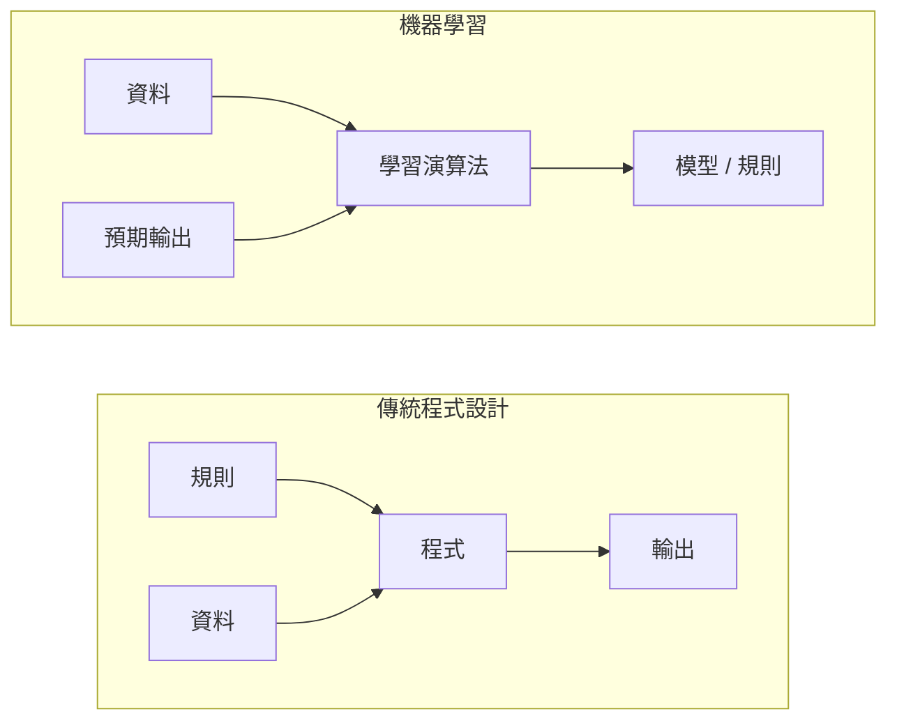
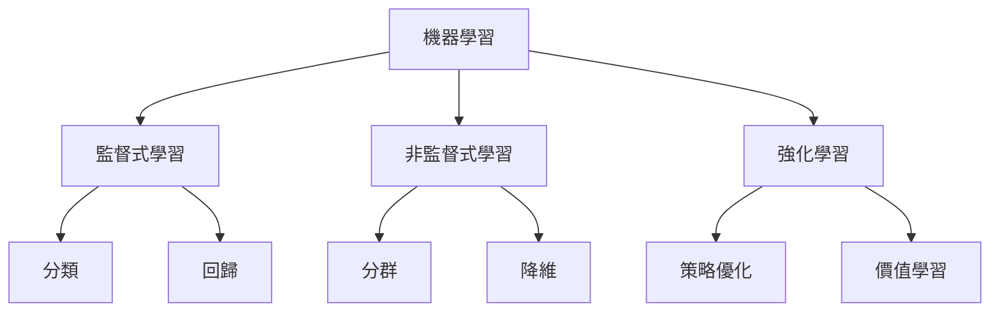
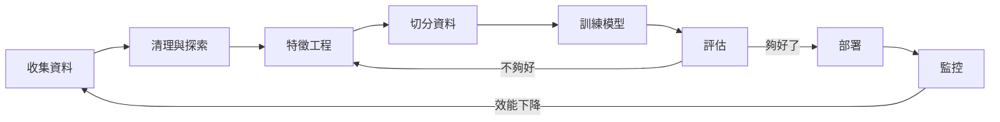
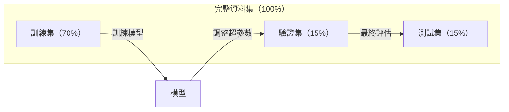
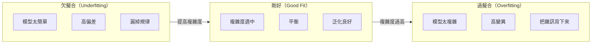
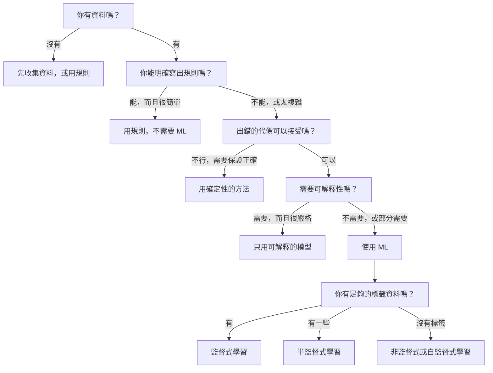

# 什麼是機器學習（What Is Machine Learning）

> 機器學習就是教電腦從資料中找出規律，而不是由人手寫規則。

**類型：** 觀念課（Learn）
**語言：** Python
**先修：** Phase 1（數學基礎）
**時間：** 約 45 分鐘

## 學習目標

- 說明監督式學習（supervised）、非監督式學習（unsupervised）與強化學習（reinforcement learning）的差別，並判斷某個問題屬於哪一種
- 從零實作「最近質心分類器」（nearest centroid classifier），並和隨機猜測的基準線（baseline）比較
- 區分分類（classification）與回歸（regression）任務，並為各自選擇適合的損失函數（loss function）
- 評估一個商業問題適合用 ML 解決，還是用確定性的規則就好

## 問題

你想做一個垃圾郵件過濾器。傳統做法是：坐下來寫幾百條規則。「如果信裡有『FREE MONEY』，標成垃圾信。如果驚嘆號超過 3 個，標成垃圾信。」你花了好幾週寫規則。接著垃圾信發送者換了用詞，你的規則就失效了。你再寫更多規則。這個循環永遠不會結束。

機器學習把這件事反過來。你不寫規則，而是給電腦幾千封標好答案（「垃圾信」或「正常信」）的郵件，讓它自己找出規則。電腦會找到你根本想不到的規律。當垃圾信發送者改變手法時，你只要用新資料重新訓練，而不必改寫程式碼。

從「寫規則」轉變為「從資料學習」，就是機器學習的核心。所有推薦系統、語音助理、自駕車和語言模型都是這樣運作的。

## 觀念

### 從資料學習，而不是從規則

傳統程式設計和機器學習解決問題的方向正好相反。



傳統程式設計：你寫規則，程式把規則套用到資料上產生輸出。

機器學習：你提供資料和預期輸出，演算法自己找出規則。

訓練產出的「模型」**就是**規則本身，只是被編碼成一堆數字（權重 weights、參數 parameters）。它從看過的範例中歸納（generalize），再對沒看過的資料做預測。

> 💡 Java 類比：傳統程式像你自己寫 `if/else` 的商業邏輯；機器學習則像是你只提供大量「輸入 → 正確輸出」的測試案例，讓演算法自動產生那段邏輯，而且產出的不是程式碼，而是一組數字。

### 機器學習的三大類型



**監督式學習（Supervised Learning）**：你有成對的輸入與輸出，模型學習從輸入對應到輸出。
- 「這裡有 10,000 張標好『貓』或『狗』的照片，學會分辨牠們。」
- 「這裡有房屋的特徵和價格，學會預測價格。」

**非監督式學習（Unsupervised Learning）**：你只有輸入，沒有標籤（label），模型自己找出資料的結構。
- 「這裡有 10,000 位顧客的購買紀錄，找出自然的分群。」
- 「這裡有 1,000 維的資料點，在保留結構的前提下降到 2 維。」

**強化學習（Reinforcement Learning）**：一個代理人（agent）在環境中採取行動，並得到獎勵或懲罰。它學習一套策略（policy），讓總獎勵最大化。
- 「玩這個遊戲。贏了 +1，輸了 -1。自己想出策略。」
- 「控制這隻機械手臂。夾起物品 +1，每浪費一秒 -0.01。」

實務上你做的東西大多是監督式學習。非監督式學習常用於前處理和資料探索。強化學習則用在遊戲 AI、機器人，以及語言模型的 RLHF（人類回饋強化學習）。

### 三大類之外

上面三類分得很清楚，但真實世界的 ML 常常界線模糊。

**半監督式學習（Semi-supervised learning）** 同時使用少量有標籤資料和大量無標籤資料。例如你可能有 100 張標好的醫學影像，和 100,000 張沒標的。常見技巧：

- **標籤傳播（Label propagation）：** 把相似的資料點連成一張圖，標籤從有標籤的節點沿著圖擴散到沒標籤的鄰居。
- **偽標籤（Pseudo-labeling）：** 先用有標籤的資料訓練模型，用它預測無標籤資料的標籤，再用全部資料重新訓練。模型自己擴充了訓練集。
- **一致性正則化（Consistency regularization）：** 對同一個輸入和它稍微變動後的版本，模型應該給出相同預測。這不需要標籤也能運作。

**自監督式學習（Self-supervised learning）** 從資料本身產生監督訊號，完全不需要人工標籤。模型根據資料的結構，自己創造預測任務。

- **遮罩語言模型（Masked language modeling，BERT）：** 把句子中 15% 的字遮住，訓練模型猜出被遮住的字。「標籤」就是原本的文字。
- **對比學習（Contrastive learning，SimCLR）：** 把一張圖做兩種變形，訓練模型認出它們來自同一張圖，並和其他圖的變形區分開來。
- **預測下一個 token（Next-token prediction，GPT）：** 根據前面所有的字預測下一個字。每份文字文件都能變成訓練範例。

> 💡 重點：GPT／ChatGPT 這類大型語言模型，就是用「預測下一個字」這種自監督方式訓練的。這也是為什麼網路上海量的文字都能直接拿來訓練，不需要人工標註。

這些並不是三大類之外的獨立類別，而是結合了監督與非監督概念的策略。自監督學習技術上算是監督式（模型在預測某個東西），但標籤是自動產生的，不是人標的。

### 分類 vs 回歸

這是監督式學習的兩種主要任務。

| 面向 | 分類（Classification） | 回歸（Regression） |
|--------|---------------|------------|
| 輸出 | 離散的類別 | 連續的數值 |
| 範例 | 「這封信是垃圾信嗎？」 | 「這間房子會賣多少錢？」 |
| 輸出空間 | {貓, 狗, 鳥} | 任意實數 |
| 損失函數 | 交叉熵（cross-entropy）、準確率 | 均方誤差（MSE）、MAE |
| 決策方式 | 類別之間的邊界 | 一條貼合資料的曲線 |

分類回答「哪一類？」，回歸回答「多少？」

有些問題兩種方式都能表述。預測股票漲或跌是分類；預測精確股價是回歸。

> 💡 Java 類比：分類的輸出像 `enum`，回歸的輸出像 `double`。

### ML 工作流程

不管用什麼演算法，每個機器學習專案都走同一條流程。



**收集資料**：取得原始資料。資料越多幾乎總是越好，但品質比數量更重要。

**清理與探索**：處理缺值、移除重複、視覺化分佈、找出異常。這一步通常佔整個專案 60–80% 的時間。

**特徵工程（Feature Engineering）**：把原始資料轉成模型能用的特徵。例如把日期轉成星期幾、把數值欄位標準化、把類別變數編碼。好的特徵比花俏的演算法更重要。

**切分資料**：分成訓練集、驗證集、測試集。模型用訓練集學習，你用驗證集調整超參數（hyperparameter），最後用測試集回報效能。

**訓練模型**：把訓練資料餵給演算法。演算法調整內部參數，讓損失函數變小。

**評估**：在驗證／測試資料上量測效能。如果不夠好，就回頭換特徵、演算法或超參數。

**部署**：把模型放上生產環境，對新資料做預測。

**監控**：持續追蹤效能。資料分佈會變（資料漂移 data drift），模型會退化。效能下降時就重新訓練。

> 💡 對 Java 工程師來說：除了「訓練模型」這一步，其他幾乎都是你熟悉的資料處理、CI/CD、部署與監控工作。這也是後端工程師轉 AI 的優勢所在。

### 訓練集、驗證集、測試集

這是初學者最常搞錯的觀念。你**必須**用模型在訓練時從沒看過的資料來評估它，否則你量到的是「背答案」，而不是「學會了」。



| 切分 | 用途 | 使用時機 | 常見比例 |
|-------|---------|-----------|-------------|
| 訓練集（Training） | 模型從這裡學習 | 訓練過程中 | 60–80% |
| 驗證集（Validation） | 調超參數、比較模型 | 每次訓練後 | 10–20% |
| 測試集（Test） | 最終、無偏差的效能估計 | 只用一次，在最後 | 10–20% |

測試集是神聖不可侵犯的，你只能看它一次。如果你一直根據測試集的表現調整模型，等於是在用測試集訓練，你回報的數字就毫無意義。

> 💡 Java 類比：就像你不能看著正式環境的考題去改程式，再宣稱「測試全過」。測試集就是那份不能偷看的考卷。

資料量小的時候，可以用 k 折交叉驗證（k-fold cross-validation）：把資料切成 $k$ 份，用 $k-1$ 份訓練、剩下 1 份驗證，輪流做完後取平均。

### 過擬合 vs 欠擬合



**欠擬合（Underfitting）**：模型太簡單，抓不到資料中的規律。就像用一條直線去貼合彎曲的關係。訓練誤差高，測試誤差也高。

**過擬合（Overfitting）**：模型太複雜，把訓練資料連同雜訊一起背下來。就像一條扭來扭去、穿過每個訓練點的曲線，但遇到新資料就失準。訓練誤差低，測試誤差高。

**剛好（Good fit）**：模型抓到真正的規律，而沒有背下雜訊。訓練誤差和測試誤差都合理地低。

過擬合的徵兆：
- 訓練準確率遠高於驗證準確率
- 模型在訓練資料上表現很好，在新資料上很差
- 增加訓練資料會改善效能（代表模型原本在背答案，而不是在學習）

過擬合的解法：
- 取得更多訓練資料
- 降低模型複雜度（更少參數、更簡單的架構）
- 正則化（Regularization，對過大的權重加上懲罰）
- Dropout（訓練時隨機把部分神經元歸零）
- 提早停止（Early stopping，驗證誤差開始上升時就停止訓練）

欠擬合的解法：
- 用更複雜的模型
- 加入更多特徵
- 減少正則化
- 訓練更久

### 偏差與變異的取捨（Bias-Variance Tradeoff）

這是過擬合與欠擬合背後的數學框架。

**偏差（Bias）**：模型假設錯誤造成的誤差。真實關係是非線性時，線性模型就有高偏差。高偏差導致欠擬合。

**變異（Variance）**：對訓練資料小幅波動過於敏感造成的誤差。高變異的模型，用不同的資料子集訓練，會得到差異很大的預測。高變異導致過擬合。

| 模型複雜度 | 偏差 | 變異 | 結果 |
|-----------------|------|----------|--------|
| 太低（用線性模型套彎曲資料） | 高 | 低 | 欠擬合 |
| 剛好 | 中 | 中 | 泛化良好 |
| 太高（用 20 次多項式套 10 個點） | 低 | 高 | 過擬合 |

$\text{總誤差} = \text{偏差}^2 + \text{變異} + \text{不可消除的雜訊}$

不可消除的雜訊你無能為力（那是資料本身的隨機性）。你要找的是讓 $\text{偏差}^2 + \text{變異}$ 最小的平衡點。

### 沒有免費午餐定理（No Free Lunch Theorem）

沒有任何一種演算法能在所有問題上都表現最好。在某類問題表現好的演算法，在另一類問題上就會表現差。這就是為什麼資料科學家會嘗試多種演算法並比較結果。

實務上，選擇取決於：
- 你有多少資料
- 有多少特徵
- 關係是線性還是非線性
- 是否需要可解釋性
- 你負擔得起多少運算資源

### 什麼時候「不要」用機器學習

ML 很強大，但不一定是對的工具。動手做模型之前，先問自己是否真的需要。

**以下情況不要用 ML：**

- **規則簡單且明確。** 稅金計算、排序演算法、單位換算。如果幾個 if 就能寫完邏輯，用模型只會徒增複雜度。
- **沒有資料或資料很少。** ML 需要範例才能學習。只有 10 筆資料，什麼有意義的東西都訓練不出來。先去收集資料。
- **出錯的代價是災難性的，你需要保證正確。** 藥物劑量計算、核反應爐控制、密碼學驗證。ML 模型是機率性的，一定有時會出錯。如果「有時會錯」不可接受，就用確定性的方法。
- **查表或簡單的經驗法則就能解決。** 如果一個門檻值或一張表就能涵蓋 99% 的情況，加入 ML 只會增加維護成本，卻沒有實質改善。
- **無法解釋決策，但法規要求可解釋。** 受監管的產業（放貸、保險、司法）有時要求每個決策都能完整解釋。有些 ML 模型可解釋（線性回歸、小型決策樹），但大多數不行。
- **問題變化的速度比你重新訓練還快。** 如果規則每天都在變，而重新訓練要一週，模型永遠是過時的。

> 💡 這段對使用 LLM 一樣適用：能用確定性程式碼解決的事，就不要丟給 AI。LLM 是機率性的，「有時會錯」是它的本質。

用這張決策流程圖判斷：



```figure
f3-learning-boundary
```

（上方 `figure` 區塊是網站專用的互動圖，在本地預覽不會顯示，可以忽略。）

## 動手做（Build It）

`code/ml_intro.py` 從零實作了「最近質心分類器」，這是最簡單的 ML 演算法。它示範了核心概念：從資料學習，再對新資料做預測。

### 步驟 1：從零實作最近質心分類器

最近質心分類器會計算訓練資料中每個類別的中心點（平均值）。預測時，把每個新資料點歸到中心點離它最近的那個類別。

```python
class NearestCentroid:
    def fit(self, X, y):
        self.classes = np.unique(y)
        self.centroids = np.array([
            X[y == c].mean(axis=0) for c in self.classes
        ])

    def predict(self, X):
        distances = np.array([
            np.sqrt(((X - c) ** 2).sum(axis=1))
            for c in self.centroids
        ])
        return self.classes[distances.argmin(axis=0)]
```

這就是整個演算法。`fit`（訓練）算出兩個平均值，`predict`（預測）算距離。沒有梯度下降、沒有迭代、沒有超參數。

### 步驟 2：用合成資料訓練

我們產生一個二維分類資料集，兩個類別有些微重疊。質心分類器會在兩個類別中心之間畫出一條直線的決策邊界。

```python
rng = np.random.RandomState(42)
X_class0 = rng.randn(100, 2) + np.array([1.0, 1.0])
X_class1 = rng.randn(100, 2) + np.array([-1.0, -1.0])
X = np.vstack([X_class0, X_class1])
y = np.array([0] * 100 + [1] * 100)
```

### 步驟 3：和基準線比較

每個 ML 模型都應該和一個簡單的基準線（baseline）比較。這裡的基準線是隨機猜一個類別。如果你的模型連隨機猜都贏不了，一定哪裡有問題。

```python
baseline_preds = rng.choice([0, 1], size=len(y_test))
baseline_acc = np.mean(baseline_preds == y_test)
```

在這個乾淨的資料集上，質心分類器的準確率應該在 90% 以上，隨機基準線約 50%。

### 為什麼這很重要

最近質心分類器簡單到不行：沒有超參數、沒有迭代、沒有梯度下降。但它涵蓋了 ML 的基本模式：

1. **學習**：從訓練資料學到一種表示方式（質心）
2. **預測**：用這個表示方式對新資料做預測（找最近距離）
3. **評估**：和基準線比較（隨機猜測）

從邏輯回歸到 Transformer，每個 ML 演算法都遵循這三步驟。表示方式會越來越複雜，但流程不變。

### 步驟 4：質心分類器做不到的事

最近質心分類器假設每個類別是一團資料，畫出的決策邊界是直線。以下情況它會失敗：

- 一個類別有多個群聚（例如數字「1」有好幾種寫法）
- 決策邊界是非線性的（例如一個類別包圍另一個類別）
- 特徵的尺度差異很大（距離會被尺度最大的特徵主導）

這些限制正是你接下來學每個演算法的動機。K 近鄰（KNN）處理多群聚、決策樹處理非線性邊界、特徵縮放解決尺度問題。每一課都建立在上一課的限制之上。

## 實際使用（Use It）

sklearn 提供了 `NearestCentroid` 和合成資料產生器：

```python
from sklearn.neighbors import NearestCentroid
from sklearn.datasets import make_classification
from sklearn.model_selection import train_test_split

X, y = make_classification(
    n_samples=500, n_features=2, n_redundant=0,
    n_clusters_per_class=1, random_state=42
)
X_train, X_test, y_train, y_test = train_test_split(X, y, test_size=0.3)

clf = NearestCentroid()
clf.fit(X_train, y_train)
print(f"Accuracy: {clf.score(X_test, y_test):.3f}")
```

## 產出物（Ship It）

這一課產出 `outputs/prompt-ml-problem-framer.md`，這是一個 prompt，能把模糊的商業問題轉成具體的 ML 任務。給它一段問題描述（例如「我們想降低客戶流失」或「預測下一季需求」），它會判斷學習類型、定義預測目標、列出候選特徵、挑選成功指標、建立基準線，並提醒資料洩漏（data leakage）或類別不平衡等陷阱。在任何 ML 專案開始時使用它，避免做錯方向。

## 關鍵術語

| 術語 | 一般人的說法 | 實際意思 |
|------|----------------|----------------------|
| 模型（Model） | 「那個 AI」 | 一個有可學習參數的數學函數，把輸入對應到輸出 |
| 訓練（Training） | 「教 AI」 | 執行優化演算法調整模型參數，讓預測符合已知的輸出 |
| 特徵（Feature） | 「一個輸入欄位」 | 資料中可量測的屬性，模型用它來做預測 |
| 標籤（Label） | 「答案」 | 訓練範例已知的正確輸出，用來計算誤差訊號 |
| 超參數（Hyperparameter） | 「可以調的設定」 | 訓練前就設定好、控制學習過程的參數（學習率、層數） |
| 損失函數（Loss function） | 「模型錯多少」 | 衡量預測和實際輸出差距的函數，訓練就是要讓它變小 |
| 過擬合（Overfitting） | 「它把考題背下來了」 | 模型學到訓練資料特有的雜訊而非通用規律，因此在新資料上失準 |
| 欠擬合（Underfitting） | 「它什麼都沒學到」 | 模型太簡單，抓不到資料中真正的規律 |
| 泛化（Generalization） | 「在新資料上也有效」 | 模型對沒訓練過的資料做出準確預測的能力 |
| 交叉驗證（Cross-validation） | 「用不同區塊測試」 | 反覆把資料切成不同的訓練／測試組並取平均，得到更穩健的效能估計 |
| 正則化（Regularization） | 「讓權重保持小」 | 在損失函數加上懲罰項，抑制過度複雜的模型 |
| 資料漂移（Data drift） | 「世界變了」 | 輸入資料的統計分佈隨時間改變，導致模型效能下降 |

## 練習

1. 拿任一資料集（例如 Iris、Titanic），按 70/15/15 切成訓練／驗證／測試集。說明為什麼不該在測試集上調整超參數。
2. 列出三個真實世界的問題。分別判斷它是分類、回歸還是分群，以及是監督式還是非監督式。
3. 某模型在訓練資料上準確率 99%，在測試資料上只有 60%。診斷問題所在，並列出三個你會嘗試的解法。

## 延伸閱讀

- [An Introduction to Statistical Learning](https://www.statlearning.com/)：免費教科書，涵蓋所有經典 ML 方法並附實例
- [Google's Machine Learning Crash Course](https://developers.google.com/machine-learning/crash-course)：簡潔、圖像化的 ML 概念入門
- [Scikit-learn User Guide](https://scikit-learn.org/stable/user_guide.html)：用 Python 實作 ML 的實用參考
